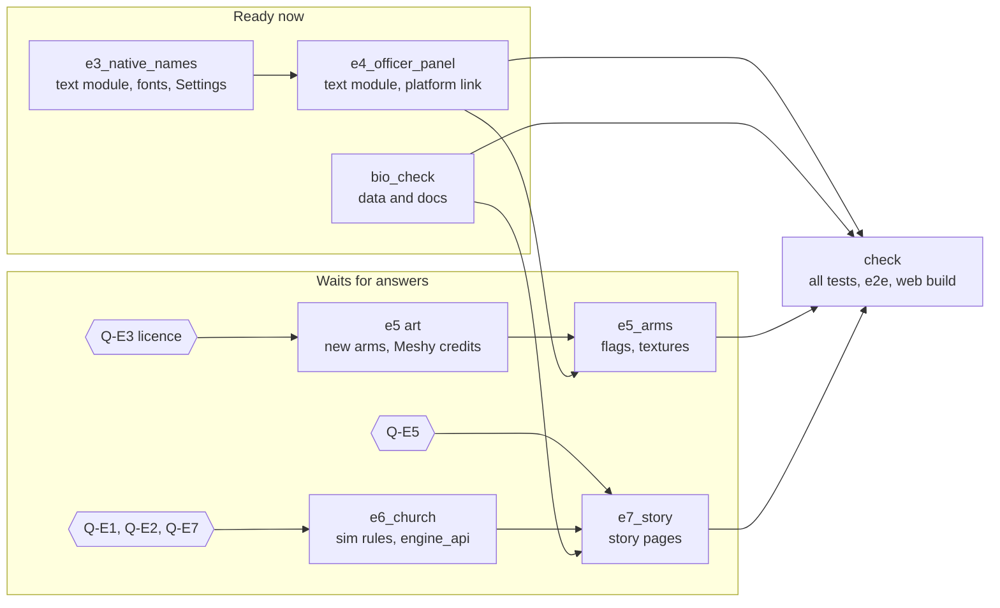

# The European game

This document is the plan for the game of the year 1200 in the pack
data/medieval_europe. It covers the requests of the player of 2026-10-28.
It gives the design, the milestones E1 to E7 and the open questions.

The requests:
1. The game starts in English, not in Chinese.
2. Each ruler and each officer has a name in their own language, with the
   accents.
3. The flag of a unit shows the coat of arms of the faction, not the
   family name of the ruler.
4. Each officer has a short life and a link to the Wikipedia article.
5. A story mode tells why the war starts and what each ruler thinks.
6. The church takes the place of the Han emperor as the source of
   legitimate power. The player asked for five authorities, after the
   lectures of Dr. Roy Casagranda.
7. English keys identify the people, the factions and the cities. Big5
   bytes are only for the display of Chinese text.

## The rule of compatibility
Each change of this plan is a change of the pack, or a change that a pack
turns on. The Three Kingdoms game does not change.
- The placeholder pack keeps zh-TW as its default locale.
- The placeholder pack keeps its names files with the Big5 keys.
- A faction without a coat of arms keeps the flag with the family name.
- The rules of the Han emperor stay in code/sim/rivals.cpp. The pack
  rules choose the emperor or the church.
- The format of a save does not change. The English keys come from the
  TSV files of the pack, by the id of each record.
- The fixtures of spec-src/spec/fixtures stay green after each step.

## E1. The default locale of a pack
A pack can name its default locale in the file pack.tsv. The file has
the columns key and value:

    key	value
    default_locale	en

When the game starts the engine of a pack, it reads pack.tsv of that
pack. If the file names a locale, the game loads that locale. If the pack
has no pack.tsv, the locale stays as it is. The placeholder pack gets a
pack.tsv with zh-TW, so that a return to the Three Kingdoms gives the
Chinese UI again.

The player can change the locale in the Settings panel. The choice holds
until the game starts the engine of another pack.

Tests:
- A unit test of the text module reads pack.tsv through the test reader.
- A ui test chooses the 1200 scenario and checks the locale after the
  restart of the engine.

## E2. English keys and the names of a pack
The engine keeps names as Big5 bytes, because the save format of the
original game holds Big5 bytes. The pack files of 1200 already give an
English key to each record:
- officers.tsv: the column key, for example philip_ii;
- forces.tsv: the column key, for example france;
- map/source/sites.tsv: the column key of each city, pass and port, for
  example paris or brenner.

The design:
1. The engine reads the keys of the pack when it loads the pack scenario.
   It also reads them when it loads a save of the pack. The id of a record
   is the same in the TSV file and in the save.
2. engine_api gets three queries: officer_key, force_key and base_key.
   Each one gives the English key of an id, or "" if the record has no key.
   A record of an original save has no key.
3. The text module loads names/<locale>.tsv of the game pack, in addition
   to the names of the placeholder pack. The keys of that file are English
   keys with a prefix:

       officer.philip_ii	Philip II Augustus
       force.france	Kingdom of France
       base.paris	Paris

4. The UI asks for the name of the key first. If the record has no key, or
   the file has no row, the UI uses the Big5 bytes as now.

The Big5 bytes stay in the record. The zh-TW locale decodes them, as now.

## E3. Names in their own language
officers.tsv gets three new columns:
- native_lang: the ISO 639-1 code of the language, for example fr, de,
  es, ca, pt, it, ar, el, bg, hu, pl, cs, da or fa;
- name_native: the name in that language and its script, with the accents,
  for example "Philippe II Auguste" or "محمد الناصر";
- name_latin: the same name in the Latin script with diacritics, for
  example "Muḥammad al-Nāṣir". For a Latin script, it is a copy of
  name_native.

The source of each native name is the title of the Wikipedia article in
that language. The research checked each title through the MediaWiki API.
Three rows use the name of 1200, not the title of a later rank:
- Baldwin IX of Flanders is "Baudouin IX de Flandre", not the Latin emperor;
- Henry of Flanders is "Henri de Flandre";
- Ugolino of Segni is "Ugolino dei Conti di Segni", not Pope Gregory IX.

An officer of England has the English name of the game as the native name.

The display:
- A new choice in the Settings panel, "Names", has the values "English"
  and "Own language".
- "Own language" shows name_latin. The fonts of the game have the Latin
  letters with diacritics. They have no Arabic, Greek or Cyrillic
  glyphs yet.
- Arabic text needs a right-to-left layout and joined letter forms. Dear
  ImGui does not do this. Thus the UI does not show the Arabic script
  until a later step adds a shaper. See question Q-E4.

The implementation:
- misc/make_scenario.py writes names/native.tsv of the pack. The row
  officer.<key> has the name_latin of the officer. The tool stops if a
  name_latin is empty or has a letter that is not Latin.
- The text module loads names/native.tsv of the game pack with the names of
  the locale. The table does not depend on the locale.
- The field native_names of text_catalog is the Names setting. If it is on,
  text_key_name looks in the native table first. A key that the native table
  lacks gives the normal name. The setting loads no file.
- The Settings panel has the combo Names. The combo sets native_names and
  commands nothing in the engine. The setting stays when the locale changes.
- The CJK font has no glyph for six letters of the native names. These
  letters are "ł", "ř", "ʿ", "ḥ", "ṣ" and "ẓ". The loader merges Noto Sans
  (SIL OFL 1.1) for the Latin Extended ranges. docs/ASSETS.md lists the font.
  The web build packs the font.

Tests:
- unit_text_native_name_tests checks the table, the setting, the fallback
  to the normal name and a pack without native.tsv.
- The ui test "names_choice_of_the_settings_panel_shows_the_native_name_of_an_officer_and_commands_nothing"
  chooses "Own language" and "English", checks the name of an officer with
  a key, and checks that the choice commands nothing.

## E4. The life of each officer
Each of the 103 officers gets a short life of three or four sentences and
the URL of the English Wikipedia article.
- The URL goes in the new column wikipedia of officers.tsv.
- The life goes in lore/<locale>.tsv of the pack, with the key
  officer.<key>. A second locale can translate it later.
- The research wrote each life in its own words. It copied no sentence of
  a source. It checked each life against the Wikipedia article through the
  MediaWiki API. A second published source is still to check for each
  life. See "The data to check".
- The officer panel shows the life under the abilities. A button opens
  the Wikipedia article. On Windows, the platform opens the link in the
  default browser. On the web, the page opens it in a new tab.

The display:
- The panel is 武將情報, in the function ui_draw_officer_detail. The life
  is a wrapped text of 28 times the height of the font, under the skill line.
- The button "Wikipedia" is after the life. Its text id is officer.wikipedia.
- An officer without a life shows no text. An officer without a link
  shows no button. The Three Kingdoms pack has no lives, so its panel does
  not change.
- The button calls the platform and commands nothing in the engine.

The implementation:
- The UI does not read officers.tsv. misc/make_scenario.py writes
  lore/links.tsv of the pack. The row officer.<key> has the URL. An officer
  with "-" has no row.
- The text module loads lore/<locale>.tsv and lore/links.tsv of the game
  pack. text_key_lore gives the life. text_key_link gives the URL.
- If the locale has no life for a key, text_key_lore gives the life of the
  fallback locale (English). The links table does not depend on the locale.
- The platform has a new function, open_url in platform_api
  (code/hexdom.h). The function gives false if it did not open the link.
- text_link_is_allowed accepts a URL only if it starts with
  https://en.wikipedia.org/wiki/ and has a name after the prefix. The URL
  must have no space and no control character. It must also have none of
  the characters " < > \ ^ ` { | }. The UI and each platform call the
  function, so a bad link never reaches the system.
- win32_open_url converts the URL from UTF-8 and calls ShellExecuteW. The
  link of a Wikipedia article can have letters outside ASCII. build.bat
  links shell32.lib for this call.
- wasm_open_url calls window.open with the target _blank and the option
  noopener. The game runs in the frame loop, not in a handler of a click of
  the page. A browser can thus block the new tab. No test checks this yet.
- The font loader scans lore/<locale>.tsv for glyphs, as it does for
  names/<locale>.tsv.
- The headless tests and demo_player give no open_url. In that case the
  panel shows no button.

Tests:
- A tool check in misc/make_scenario.py makes sure that each officer has
  a life and that each wikipedia cell is "-" or an allowed URL. The check
  uses the same rule as text_link_is_allowed.
- unit_text_lore_tests checks the lives, the fallback locale, the links
  table and a pack without lore. unit_text_link_tests checks the allowed
  and the refused URLs.
- The ui test "officer_panel_shows_the_life_and_the_wikipedia_button_opens_the_link_and_commands_nothing"
  opens the panel and checks the life. It clicks the button and checks the
  URL that the platform gets. It also checks that nothing goes to the engine.
- The ui test "officer_panel_shows_no_button_without_a_link_and_no_text_without_a_life"
  checks an officer with a life and no link, an officer without a key, and
  the Three Kingdoms pack.

## E5. The coat of arms of each faction
The flag of a unit shows the coat of arms of the faction. The arms also
show in the faction list and in the ruler list of a new game.

The design:
1. arms.tsv of the pack lists one image for each force key. The images
   are PNG files in data/medieval_europe/arms. A tool turns the SVG files
   of Wikimedia Commons into PNG files of 128 x 128 pixels.
2. The platform makes a texture from each PNG file, as it does for the
   portraits.
3. ui_draw_unit_flag draws the arms on the cloth of the flag. A faction
   without arms keeps the family name of its ruler.

The licences:
- Many images on Wikimedia Commons are in the public domain. Others have
  the licence CC BY-SA. A CC BY-SA image needs the name of the author and
  the licence in the credits. A change to the image must keep the same
  licence.
- docs/ASSETS.md and code/ui/ui_credits.cpp list each image, its author,
  its licence and its URL.
- The plan uses only public-domain images until the player agrees to CC
  BY-SA. See question Q-E3.

The research of 2026-10-28 chose one SVG file on Wikimedia Commons for
each faction. It read the licence of each file through the Commons API.
It downloaded no image.

| Force | Key | File on Commons | Licence | Public-domain choice |
|---|---|---|---|---|
| 0 | france | Blason pays fr France ancien.svg | Public domain | - |
| 1 | angevin | Coa England Country History Anjou-Plantagenêt (1198-1340).svg | CC0 | - |
| 2 | toulouse | Blason département fr Hérault.svg (the cross of Toulouse) | Public domain | - |
| 3 | aragon | Coa Spain Family Royal arms of Aragon.svg | CC0 | - |
| 4 | castile | Escudo de armas de Castilla.svg | CC0 | - |
| 5 | leon | Shield of Alfonso IX of Leon.svg | CC BY-SA 3.0 | Kingdom of Leon Medieval Heraldic Lion.svg |
| 6 | portugal | CoA of Portugal (1139-1247).svg | CC BY-SA 3.0 | Banner of Portugal 1248.svg |
| 7 | almohad | Almohad flag.svg | CC0 | - |
| 8 | ghaniya | Banner of the Almoravids.svg | Public domain | - |
| 9 | ayyubid | Flag of Ayyubid Dynasty.svg (Commons marks it for deletion) | Public domain | - |
| 10 | byzantium | Byzantine imperial flag, 14th century, square.svg | Public domain | - |
| 11 | bulgaria | Coat of arms of the Second Bulgarian Empire.svg | CC BY-SA 3.0 | none found |
| 12 | rum | Double-headed eagle of the Sultanate of Rum.svg | CC0 | - |
| 13 | staufer | Armoiries empereurs Hohenstaufen (DL).svg | Attribution | none found |
| 14 | welf | Emperor Otto IV Arms (DL).svg | Attribution | none found |
| 15 | sicily | Coat of Arms of the Kingdom of Sicily (House of Hohenstaufen).svg | CC BY-SA 4.0 | none found |
| 16 | austria | CoA Babenberg (old).svg | CC0 | - |
| 17 | bohemia | Přemyslovci erb.svg | Public domain | - |
| 18 | hungary | Coa Hungary Country History Imre (1196-1204).svg | Public domain | - |
| 19 | poland | POL Przemysł II 1295 COA.svg | Public domain | - |
| 20 | papacy | Emblem of the Papacy SE.svg | Public domain | - |
| 21 | venice | Flag of Most Serene Republic of Venice.svg | Public domain | - |
| 22 | flanders | Arms of Flanders.svg | CC0 | - |
| 23 | denmark | Royal Banner of Denmark (14th Century).svg | Public domain | - |

The result:
- 18 factions have a public-domain or CC0 image.
- Leon and Portugal have a CC BY-SA image and a public-domain choice.
- Staufer and Welf need the credit "David Liuzzo" under an attribution
  licence.
- Bulgaria and Sicily have only CC BY-SA images.
- The arms of Byzantium, Bulgaria, Rum, Sicily, Poland, the papacy and
  Venice are later attributions, not arms of 1200.

Some factions of 1200 had no coat of arms. Heraldry started in western
Europe in the 12th century. The Almohads, the Ayyubids, Byzantium and the
Seljuks used banners and seals. For these factions, the plan uses a banner
of the period, or a later attribution with a note.

## E6. The authorities of the church
This section is a design. The work starts after the player answers Q-E1,
Q-E2 and Q-E7.

In the Three Kingdoms game, the Han emperor gives legitimacy. The faction
that holds his city gains technique points each month. Officers who
respect the Han gain loyalty. The rank of emperor needs the protection of
the emperor.

In 1200, the church gave legitimacy to the kings of Christian Europe. The
pope crowned kings and released subjects from their oaths. Five sees had
the rank of patriarch since the Council of Chalcedon in 451. Historians
call this group the Pentarchy:
1. Rome, the see of the pope;
2. Constantinople;
3. Alexandria;
4. Antioch;
5. Jerusalem.

Dr. Casagranda tells the same five in his lecture "The Crusades: Part 1"
of 27 March 2023, near minute 53. In his words, the old church had two
popes, two patriarchs and an archbishop. The popes sat in Rome and in
Alexandria. The patriarchs sat in Antioch and in Constantinople. The
archbishop sat in Jerusalem. In his account, the pope of Rome did not
accept a rank of one in five. The quarrel grew into the split of the East
and the West. Other sources correct two details of the lecture:
- The split has the date 1054, not 1058.
- The see of Jerusalem had the rank of patriarch from 451.

The holders of the five sees on 1 January 1200:

| See | Latin holder | Greek or Coptic holder | City on the map | Owner in 1200 |
|---|---|---|---|---|
| Rome | Innocent III, 1198 to 1216 | none | Rome, 20 | papacy |
| Constantinople | none until Thomas Morosini, 1204 | John X Kamateros, 1198 to 1206 | Constantinople, 15 | byzantium |
| Alexandria | none | Mark III, 1180 to 1209. Coptic pope John VI, 1189 to 1216, in Cairo | Alexandria, 12 | ayyubid |
| Antioch | Peter of Angouleme, 1196 to 1208 | in exile in Constantinople | not on the map | Bohemond III, not a faction |
| Jerusalem | Aymar the Monk, 1194 to 1202, in Acre | Mark II, uncertain | Jerusalem, 14 | ayyubid |

The Muslim rulers took their legitimacy from a caliph. The rules of the
caliph are not the rules of the church:
- The Ayyubids named the Abbasid caliph al-Nasir li-Din Allah in the
  Friday sermon and on their coins. He ruled in Baghdad from 1180 to 1225.
  Baghdad is not on the map.
- The Almohads did not accept Baghdad. Their own ruler had the title of
  caliph.
- The Banu Ghaniya were heirs of the Almoravids. The Almoravids accepted
  the caliph of Baghdad in name.
- The Seljuks of Rum received envoys of the caliph. The research found no
  diploma of the caliph to Rum near 1200.

Dated facts for the rules:
- 1179: the bull Manifestis Probatum made Afonso Henriques king of
  Portugal. Portugal paid the pope each year.
- 1198: Innocent III put Leon under interdict. He did not accept the
  marriage of Alfonso IX and Berenguela.
- January 1200: Innocent III put France under interdict. Philip II did not
  accept his wife Ingeborg. The pope stopped the interdict in September.
- 1201 and 1202: Innocent III chose Otto IV as king of Germany. The
  decretal Venerabilem of 1202 claimed the right of the pope to judge
  between two kings.
- 8 November 1204: a legate of the pope crowned Kaloyan at Tarnovo. The
  pope gave the title of king, not of emperor.
- 11 November 1204: Innocent III crowned Peter II of Aragon in Rome.
- 1208 to 1214: England was under interdict. The pope excommunicated John
  in 1209. In 1213 John made England a fief of the pope.
- 1209 and 1210: Innocent III crowned Otto IV emperor, then excommunicated
  him one year later.

The proposed rules:
- authorities.tsv of the pack lists the five sees: a key, the city of the
  see, the holder in 1200 and the church of the holder.
- rules.tsv gets legitimacy.model with the values emperor and
  authorities. The placeholder pack keeps emperor.
- Each month, the faction that holds the city of a see gains technique
  points. Devout officers of that faction gain loyalty. These are the
  rules of the emperor, for each see.
- The rank of king or emperor needs the recognition of one authority.
  A faction gets recognition if it holds the see, or if the holder of the
  see is its ally.
- A new command lets a faction ask the pope for a crown. The pope gives
  it to a faction with a high friendliness. Kaloyan of Bulgaria got his
  crown from Innocent III in 1204. Innocent III crowned Peter II of Aragon
  in Rome in 1204.
- The pope can excommunicate a ruler or put a land under interdict.
  Innocent III put France under interdict in 1200. Then the officers of
  that faction lose loyalty each month.

The facts of this section come from sources that the research checked.
The list of sources is in the section "The sources".

## E7. The story mode
The story mode tells the background of the war before the first turn. It
is a series of pages with text and a map.

The pages:
1. Europe in 1200. The page shows these powers:
   - the Angevin lands in France and the Reconquista in Spain;
   - the Almohads in Africa and the heirs of Saladin in Egypt and Syria;
   - the weak Byzantine Empire and the two kings of Germany.
2. The authorities. The pope Innocent III and his claim over the kings.
   The five sees and the split of 1054 between Rome and Constantinople.
3. The sparks of the war. The interdict on France in 1200. The death of
   Richard I in 1199 and the claim of Arthur of Brittany. The call of a new
   crusade in 1198. The double election in Germany in 1198.
4. One page for each ruler. What the ruler wants, whom the ruler fears,
   and the first goal of the ruler in 1200.

The story mode is a front-end feature. It reads story/<locale>.tsv of the
pack and draws the pages. It sends no command to the engine.

Later, dated events during the game can continue the story. Examples:
- the Fourth Crusade in 1202;
- the sack of Constantinople in 1204;
- the battle of Las Navas de Tolosa in 1212;
- the battle of Bouvines in 1214.

These events need rules in events.tsv of the pack. See question Q-E5.

## The sources
The player likes the lectures of Dr. Roy Casagranda. The plan uses them as
a source of ideas and of the frame of the story. The plan does not copy
his words, because the lectures are under copyright.

Each fact of the game must have two sources or more, for example:
- the English Wikipedia article of the person;
- Encyclopaedia Britannica;
- a published history, for example the works on Innocent III.

## The data to check
The check of 2026-10-28 compared each life and each year with a second source. The file docs/europe/SOURCES.md lists the sources of each officer. The game data changed where two sources agree. The differences below stay open. The game data does not change until two sources agree.

Years that the sources give in different ways:
- 6 Montfort: born near 1165 or near 1175. The data has 1175.
- 14 Longespee: one source says born in 1167 or before. The English article says 1176. The data has 1176.
- 34 Al-Nasir: born in 1181 or in 1182. The data has 1182.
- 46 Laskaris: born in 1174 or in 1175. The data has 1174.
- 52 Suleiman II: born in 1158, 1160 or 1166. The data has 1160.
- 54 Philip of Swabia: born in 1177 or in 1178. The data has 1177.
- 55 Kalden: born near 1175 or near 1145. The data has 1150.
- 80 Ugolino: born near 1145 in the Catholic Encyclopedia, and near 1170 in Treccani. The data has 1145.
- 82 Ranieri Dandolo: died in 1208 or in 1209. The data has 1209.
- 83 Ziani: the English article says died on 13 March 1230. Treccani and one other source say 1229. The data has 1229.
- 86 Henry of Flanders: born in 1174, 1176 or 1178. The data has 1176.
- 91 Sunesen: born near 1165 in two Danish sources. The data has 1167.
- 94 Kaykhusraw I: born in 1169, 1171 or 1177. The data has 1164.
- 20 Peter II: some sources say that Innocent III crowned him in 1204, and others say 1205. The life says 1204.

Years that have no source or only one source:
- 18 Foix, 36 Abu Hafs, 50 Boril, 51 Strez and 95 Sgouros: no source gives a birth year. The sources for Sgouros say only "before 1170".
- 22 Montcada: the sources say only "12th century". The year 1150 is improbable.
- 57 Ludolf: Deutsche Biographie says born near 1125. The data has 1140.
- 64 Pagliara, 79 Capuano and 87 Bethune: the sources give only a limit, for example "before 1160".

Lives that have a weak second source:
- 35 Ibn Jami: only the article of al-Nasir names him. He was vizier from approximately 1205, not in 1200.
- 38 Yahya ibn Ghaniya: the English article of that name names another man. The officer has no English article.
- 57 Ludolf, 60 Henry of the Palatinate, 61 Henry of Brabant and 64 Pagliara: one source only.
- The "SOURCES.md" file marks the other weak sources.

Ten officers have no English article and have "-" in the column
wikipedia: 3, 4, 19, 22, 33, 35, 38, 57, 78 and 82.

## The milestones
| Step | Work | Needs an answer | Status |
|---|---|---|---|
| E1 | pack.tsv and the default locale | no | done |
| E2 | English keys in engine_api, names of the pack | no | done |
| E3 | Native names in officers.tsv and the Names setting | Q-E4 for Arabic | done, Latin script only |
| E4 | Lives and Wikipedia URLs, the officer panel | no | done |
| E5 | Coats of arms on the flags | Q-E3 | research |
| E6 | The authorities of the church | Q-E1, Q-E2, Q-E7 | design |
| E7 | The story mode | Q-E5 | design |

## The stage runs
misc/run_stages.py runs the stages as headless Claude Code sessions, in
parallel. Each session works in its own worktree and bills the API key of
the player. A stage is a brief in misc/stages/<stage>.md. The rules of all
stages are in misc/stages/common.md.

The stages that need no answer now:
- e3_native_names: the Names setting of E3;
- e4_officer_panel: the life and the Wikipedia button of E4;
- bio_check: a second source for each life of E4.

E5, E6 and E7 get a brief after the player answers their questions.

### The order of the stages
misc/stages/plan.tsv gives the order. A stage waits for another stage only
for a real need: a result that it uses, or a file that both stages edit.
All other stages run in parallel.

The reasons for each arrow:
- e3_native_names before e4_officer_panel: both edit the text module and
  misc/make_scenario.py.
- e4_officer_panel before e5_arms: both add a function to the platform
  contract in code/hexdom.h.
- e6_church before e7_story: the story tells the rules of the
  authorities.
- bio_check before e7_story: the pages of the rulers use the checked
  facts.
- e6_church edits code/sim/ and engine_api. It can run in parallel with
  e3_native_names and e4_officer_panel.

To run the stages:
1. Set the API key in your own terminal, not in a chat. The key goes into
   the user environment and stays out of the repository. The tool reads
   CLAUDE_API_KEY or ANTHROPIC_API_KEY:

       [Environment]::SetEnvironmentVariable("ANTHROPIC_API_KEY", "<key>", "User")

2. Print the waves of the plan. This step starts nothing:

       python -X utf8 misc\run_stages.py --plan --dry-run

3. Start the plan from the root of the repository. The tool stays open
   until the last stage ends:

       python -X utf8 misc\run_stages.py --plan

4. Look at the progress in another terminal:

       python -X utf8 misc\run_stages.py --status

To start one stage without the plan, give its name:

    python -X utf8 misc\run_stages.py bio_check

The tool makes the worktree ..\hexdom-<stage> on the branch
stage/<stage>. The session writes its output to build\stage.jsonl of that
worktree. The option --budget sets the largest cost of one session in
US dollars. The default is 20. The option --model sets the model. The
default is claude-sonnet-5-5. For bio_check, claude-haiku-5-5 costs less.

The session can edit files and run commands in its worktree. It cannot
force a push, reset a branch, delete a folder tree or use the stash. Each
session pushes to origin master after its tests pass. Two sessions can
edit the same file, for example the text module. Then the second session
merges the work of the first in its rebase.

## The open questions
- Q-E1. The five authorities. Dr. Casagranda names the Pentarchy: Rome,
  Alexandria, Antioch, Constantinople and Jerusalem. Is this the group of
  the player? Another choice is a group of the West: the pope and four
  great archbishops.
- Q-E2. The Muslim factions. Does the caliph of Baghdad act as a sixth
  authority for the Ayyubids and the Seljuks?
- Q-E3. The licence of the arms. Can the game use CC BY-SA images? Each
  one then needs credits, and a changed image keeps CC BY-SA.
- Q-E4. The scripts. Must the UI show Arabic, Greek and Cyrillic names in
  their own script? This needs new fonts and a shaper for Arabic.
- Q-E5. The story during the game. Must the story mode continue with
  dated events, or only give the background before the first turn?
- Q-E6. The Three Kingdoms keys. Must the Three Kingdoms game also move
  to English keys? This needs a table of keys for approximately 1000
  officers of the original saves.
- Q-E7. Antioch is not a city of the map. Its see can stand in Jerusalem,
  in Konya, or in a new city. Another choice is a see without a city, held
  by no faction.
