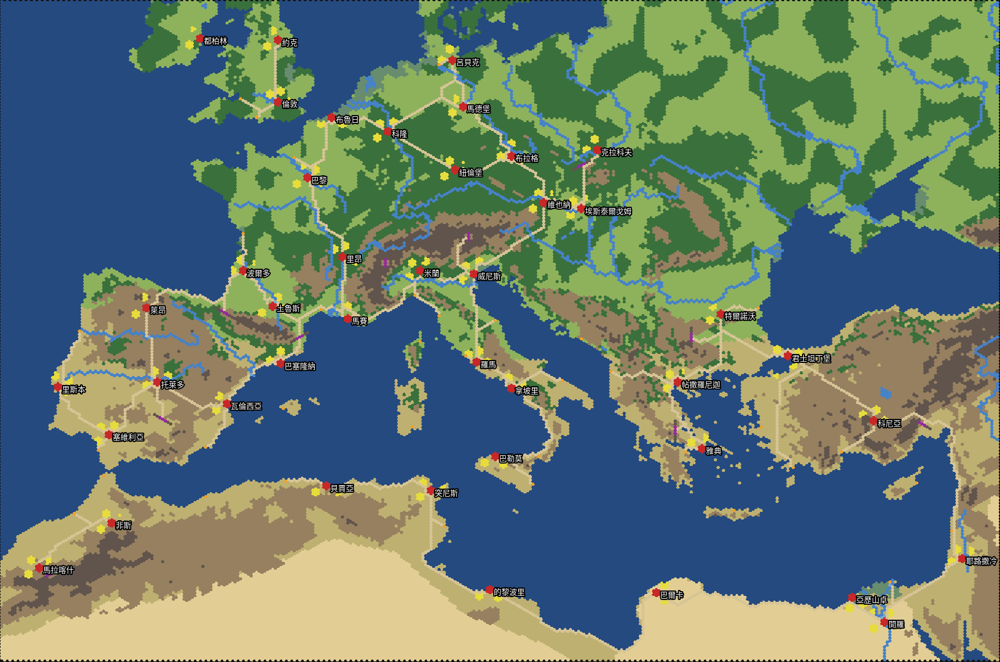
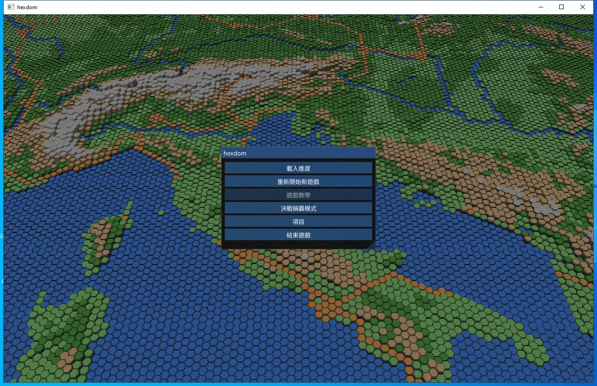

# Maps from real geography

This document is the plan for maps of other regions and other periods. It
also tells how to make a map with misc/make_world_map.py. The first map is
the prototype data/medieval_europe: Europe and North Africa in 1200.

## The goal
The engine runs the same rules on any map. One content pack holds one
game: the rules, the map, the cities and later the scenario. Planned games:

| Game | Region | Period |
|---|---|---|
| medieval_europe (prototype) | Europe and North Africa | 1200 |
| Thirty Years War | Europe and the Middle East | 1618 |
| American Revolution | Eastern North America, Britain and France | 1775 |
| East Asia | China, Korea, Japan and Southeast Asia | to be decided |
| South Asia | India and its neighbours | to be decided |

## The scale of the placeholder map
A new map must feel like the placeholder map. Two numbers give the feel.
- The size of a hex. The 42 cities of the placeholder map stand where the
  real Han cities stood. A fit of their hexes to their real positions
  gives 9.5 km for each column and 9.4 km for each row. Thus the centres
  of two hexes are approximately 11 km apart. The map is 200 x 200 hexes,
  approximately 1900 km x 1900 km.
- The distance between cities. The median distance from a city to the
  nearest city is 22 hexes. The smallest is 13 and the largest is 29.

The distance between cities controls the game. It sets the days of a
march, the size of a region and the number of hexes between two armies.
The tool keeps this number and changes the size of a hex. The setting
city_spacing_hexes of region.tsv holds the number. The default is 22.

The prototype has 277 km between neighbour cities. The tool makes hexes of
13.6 km, so that the median distance is 21.5 hexes. The map is 372 x 213
hexes, two times the area of the placeholder map.

## The limits of the engine
These limits come from the engine as it is now. The tool checks them.
- A map has 42 cities with the ids 0 to 41 (SAVE_CITY_COUNT).
- A map has 45 other bases: passes and ports, with the ids 42 to 86.
  bases.tsv must have each id one time (CONTENT_BASE_COUNT).
- The terrain mesh needs approximately 1.65 KB of frame memory for each
  hex. The frame block is 160 MB on Windows and on the web. Thus a map
  has 80000 hexes or less. The setting max_hexes holds this limit. If a
  map needs more hexes, the tool makes the hexes larger.
- An officer name has two parts of two Chinese characters each. The record
  holds 5 Big5 bytes for each part, with the NUL. A city name holds 8
  characters, and the name of a pass or a port holds 12.
- The rules of a pack must end after its start year. rules.tsv of the
  prototype sets game.end_year to 1360. A pack that keeps 351 loses by
  time at the first turn.

## The sources of the data
Each source in this table lets you sell a game that contains its data.
A subagent checked each licence on the official page on 2026-10-27. This
is not legal advice. Check the licence again before a release.

| Use | Source | Licence | Notes |
|---|---|---|---|
| Height (used) | NOAA ETOPO 2022, 60 arc-seconds | U.S. Government work, no licence stated | Cite doi:10.25921/fd45-gt74 |
| Coasts, lakes, rivers, deserts (used) | Natural Earth 1:50m | Public domain | Credit is optional |
| Height, other choices | GEBCO grid | Public domain | Acknowledge GEBCO |
| | USGS GMTED2010, SRTM | Public domain | "Courtesy of the U.S. Geological Survey" |
| | NASA ASTER GDEM v3 | Open, no restriction | Cite doi:10.5067/ASTER/ASTGTM.003 |
| Climate and land cover | Koppen-Geiger maps (Beck 2018, 2023) | CC BY 4.0 | The Figshare record says CC BY. One page links to CC BY-NC. Ask the authors. |
| | ESA WorldCover | CC BY 4.0 | Modern land cover, not medieval |
| | MODIS MCD12Q1 | NASA data, CC0 by NASA policy | Modern land cover |
| City positions and dates | Wikidata | CC0 | Coordinates, founding dates, names in each language |
| | Pleiades | CC BY 3.0 | Ancient and medieval places |
| City populations | Bosker, Buringh and van Zanden (Europe and MENA, 800 to 1800) | CC0 (Harvard Dataverse) | Cite the paper |
| | Buringh, European urban population 700 to 2000 | CC0 (DANS) | |
| | Reba, Reitsma and Seto 2016 (NASA SEDAC) | Not stated | Use only after the terms are clear |
| Roman roads | Itiner-e | CC BY 4.0 | Medieval roads follow most Roman roads |
| Rivers, more detail | HydroRIVERS | Custom licence, commercial use allowed | Ship it only inside the game. The EULA must protect the data. Credit text is mandatory. |

Do not use these sources in a commercial game:
- DARMC (Harvard): CC BY-NC-SA.
- CHGIS (China Historical GIS): no commercial use. Use Wikidata for China.
- Euratlas: a paid licence. The simple licence stops the distribution of
  the vectors.
- aourednik/historical-basemaps: GPL 3.0, and the sources of the borders
  are not clear.
- OpenStreetMap: ODbL. A hex layer from OSM data is probably a derived
  database. You must then publish it under ODbL.

No free source gives historical borders that you can sell. Draw the
borders by hand from the city positions. The engine does not need borders,
because the owner of a city makes the border.

USGS EarthExplorer and the NASA Earthdata portals give the same kind of
data as the table: heights and land cover. All of it is open. For hexes of
10 km and more, ETOPO and Natural Earth are sufficient. A higher
resolution does not change a hex.

## How the tool makes a map
misc/make_world_map.py reads two files of the pack and writes four files.

| File | Who writes it | Contents |
|---|---|---|
| map/source/region.tsv | you | The box, the scale and the thresholds |
| map/source/sites.tsv | you | 42 cities, 10 passes, 35 ports: name, latitude, longitude, slots, specialty |
| map/hexes.tsv | the tool | The 14 columns of formats/map-data.md for each hex |
| map/bases.tsv | the tool | The hex of each city, pass and port |
| cities.tsv | the tool | The specialty and the slots of each city |
| bases.tsv | the tool | The owner and the durability of each pass and port |

The steps of the tool:
1. Project the map. The projection is Lambert azimuthal equal-area, with
   its centre in the middle of the box. The map is the box of the sites
   plus margin_hexes on each side.
2. Sample seven points in each hex: the centre and six points half a hex
   away. Each point gets a height from ETOPO and a land or water value
   from the Natural Earth land and lakes.
3. Give a terrain to each land hex. The rules use the mean height, the
   largest height, the latitude, the Natural Earth deserts and deltas, and
   a value noise for the forests.
4. Add the rivers. The Natural Earth rivers with a scalerank of 6 or less
   become 河 river hexes.
5. Put each city on a flower of seven 都市 hexes. Put each pass on a wall
   of 關所 and 崖 hexes across the ridge. Put each port on a shore hex.
6. Make roads between neighbour cities with an A* search. A road that
   crosses a river makes a 渡所 ford.
7. Make the regions with a Dijkstra search from all bases. The sea belongs
   to the nearest port.
8. Put the development slots in clusters of up to seven hexes, 4 to 9
   hexes from the city. Put three bandit sites near each city.

The tool writes build/maps/<pack>.png, a picture of the map with the
city names. Look at it before you start the game.

## Make a map
1. Copy data/medieval_europe to data/<name>. Keep the tables that the tool
   does not write.
2. Edit map/source/region.tsv. Set the box and the year.
3. Edit map/source/sites.tsv. Get the latitude and the longitude of each
   site from Wikidata.
4. Run this command from the root of the repository:

       python -X utf8 misc\make_world_map.py data\<name>

5. Look at build\maps\<name>.png. Change the sites or the thresholds and
   run the tool again. The second run uses the cache in build\geo_cache
   and needs no network. Add --offline to make sure of this.
6. Start the game with the pack:

       build\win32_hexdom.exe --pack <name>

The fonts, the UI text and the art stay in data/placeholder. The rules,
the map and the scenario list come from the pack.

The feature test tests/feature/world_map_tests.cpp loads the prototype
through engine_api. It checks the counts of the map, loads the scenario of
the pack and plays two turns of the AI.

## The scenario of a pack
A pack can have scenarios of its own in TSV files. Then the pack needs no
save and no scenario file of the original game. The prototype has one
scenario: 1200, with 24 factions and 103 historical officers.

scenarios.tsv lists the scenario with the kind pack. Its file is the
scenario.tsv of a scenario folder, relative to the pack folder:

    0	y1200	一二〇〇年 群王爭霸	1200	pack	scenarios/y1200/scenario.tsv	assumed

The scenario folder holds four files.

| File | Rows | The engine reads |
|---|---|---|
| scenario.tsv | key and value | year, month, ten_day, number |
| forces.tsv | one row for each faction | id (the force id, 0 up), ruler (an officer id) |
| officers.tsv | one row for each officer | the Big5 name, the years, force, city, status, the five abilities, aptitudes, skill, loyalty, merit, compatibility |
| cities.tsv | 42 rows | owner, governor, troops, gold, food, spears, halberds, crossbows, horses, durability |

The rules of the files:
- status is ruler, officer or free. A free officer has the force -.
- Each faction has one ruler, and forces.tsv names it. The ruler is an
  officer of the faction.
- An officer stands in a city of its own faction. A free officer can
  stand in any city.
- governor is an officer of the owner in that city, or -. The engine
  makes that officer a governor.
- A city with the owner - has no soldiers.
- aptitudes are six letters for pike, halberd, crossbow, cavalry, siege
  and navy: C, B, A or S.
- skill is a key of skills.tsv, or -.

The names of the cities, the passes and the ports are the name_big5
column of cities.tsv and bases.tsv of the pack. misc/make_world_map.py
writes that column from name_zh. After the load of a pack scenario, the
engine gives the sim the new game and then the names.

You write family_zh and given_zh of officers.tsv in Chinese. Then run this
command. It writes the Big5 columns and checks the rules above with the
row of each error:

    python -X utf8 misc\make_scenario.py data\<name>\scenarios\<key>

The UI names a pass or a port with the UI string "base.<key>". If the
string does not exist, it uses the name of the name index. The passes and
the ports of a pack thus show the names of its bases.tsv.

## A new game of another pack
The scenario list of the title shows the scenarios of other packs too. The
game starts with data/placeholder, and its scenarios.tsv has the 1200
scenario of medieval_europe as row 8. The column pack names the pack of a
row, or "-" for the pack of the engine:

    8	y1200	一二〇〇年 群王爭霸	1200	pack	scenarios/y1200/scenario.tsv	assumed	medieval_europe

The file of such a row is relative to the folder of that pack. The rows 1
and 2 of medieval_europe/scenarios.tsv lead back to the Three Kingdoms.

When the player chooses a row of another pack, these steps occur:
1. ui_choose_scenario puts the pack and the key of the scenario in
   ui.game.pack_request and ui.game.pack_scenario. It loads nothing.
2. After the frame, the game (code/hexdom.cpp) empties the arena of the
   engine. It creates a new engine with the rules and the map of that
   pack, and a new UI at the title.
3. In the next frame, ui_start_pack_scenario loads the scenario of the key
   from the list of the new engine. Then the ruler list opens.

The fonts, the UI text and the art stay the same for all packs.

The web build has the pack in index.data: build_web.bat preloads
data/medieval_europe. The Playwright test "a new game of 1200 starts the
engine again with the map of Europe" chooses the row in the browser and
checks the size of the new map.

Caution: a save holds the size of its map, and an engine refuses a save of
another size (ENGINE_SAVE_OTHER_VERSION). The title starts the engine of
the placeholder pack. Thus a save of a 1200 game does not load from the
title yet. The next step puts the pack in the save, so that the load
starts the engine of that pack first.

## The plan
| Step | Work | Result |
|---|---|---|
| W1 (done) | The tool, the prototype pack, --pack, a feature test | The engine plays on Europe and North Africa |
| W2 (done) | A scenario of the pack: forces, officers and city names in TSV files, not a save | Each game has its own people and names |
| W3 | Counts from the pack: the number of cities, passes and ports | A map with 60 or 120 cities |
| W4 | A terrain mesh in chunks, built for the view only | Maps of 300000 hexes and more |
| W5 | Better data: Itiner-e roads, city sizes from Bosker-Buringh, the Koppen climate for the terrain | Roads and forests closer to history |
| W6 | One pack for each planned game | The games of the table above |

W3 and W4 are necessary for the large regions. A pack scenario has no
English names yet. The English UI shows the Chinese names, because the
names/en.tsv of the placeholder pack has only the Three Kingdoms names.

## The regions of the planned games
The table gives the hexes at the scale of the placeholder map, 11 km
between hex centres. A region with more than 80000 hexes needs W4, or
larger hexes. A region with many more than 42 important cities needs W3.

| Game | Area | Hexes at 11 km | Advice |
|---|---|---|---|
| medieval_europe | 4500 km x 3000 km | approximately 125000 | Done with 13.6 km hexes and 42 cities |
| Thirty Years War | 4700 km x 2800 km | approximately 125000 | Needs W3: the Empire alone has more than 42 important towns |
| American Revolution | Two theatres | 31000 for the Thirteen Colonies | Make two maps. The Atlantic is 5000 km and has no hexes of interest. A sea voyage between the maps is an event, not a march. |
| East Asia | 6000 km x 5000 km | approximately 300000 | Needs W3 and W4, or one map for each subregion |
| South Asia | 3500 km x 3500 km | approximately 125000 | Possible with 15 km hexes and 42 cities |

Large maps are slow to play if the hexes stay small. Keep the distance
between cities near 22 hexes. Choose the cities first, then let the tool
choose the size of a hex.
