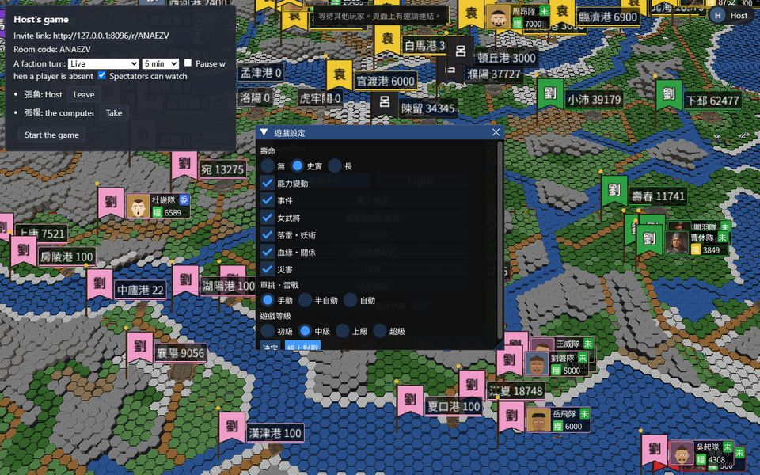
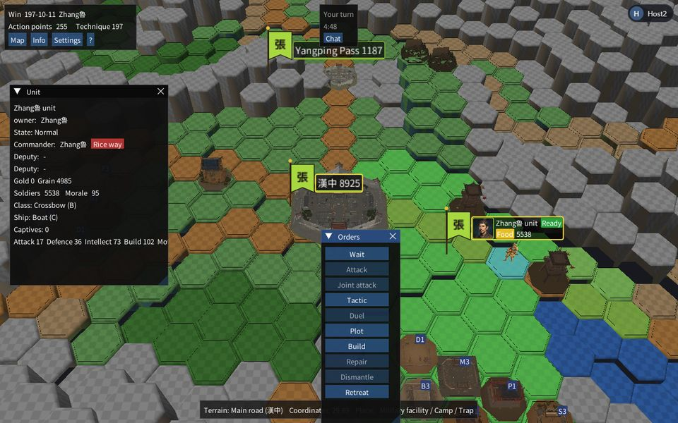
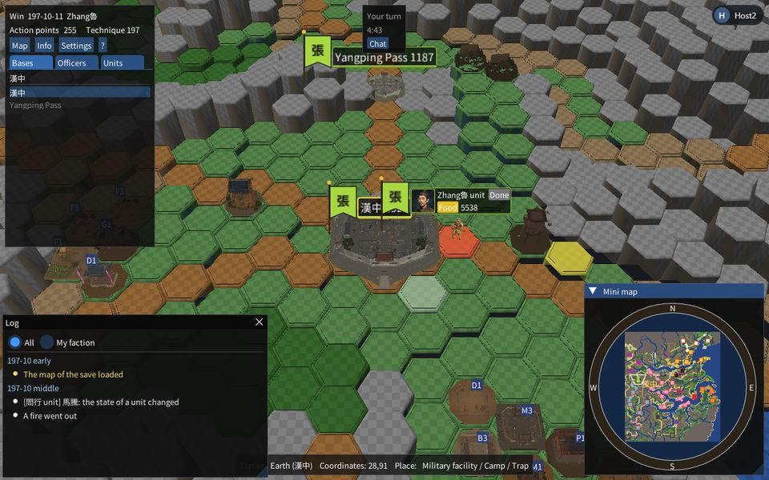
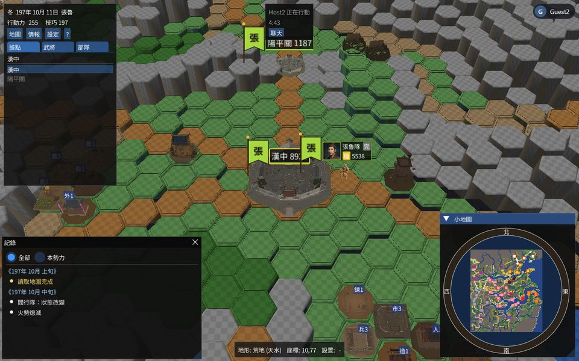
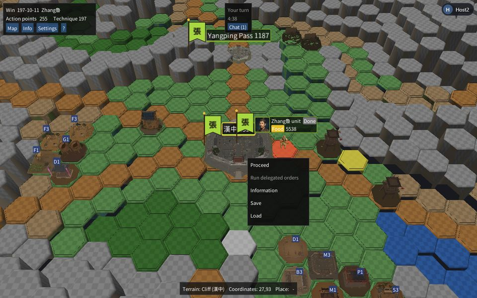

# Try the multiplayer yourself

This guide gives the steps to prove that a shared game works. Do the three parts in this order:

| Part | What it proves | Time | What you need |
|---|---|---|---|
| A. The automatic tests | The server and the browser flows pass | 6 min | This PC |
| B. Two windows on this PC | You see the same game in two windows. The checksums agree. The alarm rings on a false checksum. | 20 min | This PC, and Chrome |
| C. The live site | The real site works for two real accounts | 15 min | Two accounts, and a second person if possible |

## The idea of the proof
Each page runs its own copy of the engine. The pages do not send the game state. They send only the commands, as numbered steps. The server gives one order to the steps.

After each step, each page computes a checksum of its full game state and reports it to the server. If two reports differ, the server stops the game.

Thus three facts prove a shared game:
1. The two pages have the same number of steps.
2. The two pages have the same checksum.
3. A false checksum makes the alarm ring. Without this fact, facts 1 and 2 prove less.

## The results of the first run
The author ran these checks on 2026-11-01, on build 410 of the test game.

| Check | Result |
|---|---|
| `run_tests.bat --server` | All pass |
| 9 browser tests of part A | 9 passed, in 4.9 min. These tests include B9 and B10 as scripts. |
| B3, the start | Same steps (0), same checksum |
| B4, a move with real clicks | Same steps (2), same checksum |
| B5, the chat | The line reached the page of the guest |
| B6, the end of a turn with real clicks | Same steps (3), same checksum |
| B7, a reload of the guest | Same steps (3), same checksum |
| B8, a false checksum | The alarm rang, and the guest got the good state back in less than 1 s |
| Part C | Not done. The author cannot sign in to an account. This part is for you. |

## Part A. The automatic tests
Run these commands in PowerShell, in `D:\src\hexdom`.

1. Run the tests of the room server:

```powershell
.\run_tests.bat --server
```

The result is `ALL PASS` at the end.

2. Run the tests of the browser. Each test starts two or three browser sessions.

```powershell
Set-Location tests\web; npm test -- multiplayer rooms resume absence spectator token desync; Set-Location ..\..
```

The result is `9 passed`.

If a command cannot find a file, build the file first. See "The builds" at the end of this guide.

These tests cover these flows:

| Test file | Flow |
|---|---|
| multiplayer.spec.js | Two members start one game from an invite link. Each page has the same state. |
| rooms.spec.js | The socket refuses a person without a session, and a page of another site. |
| absence.spec.js | The AI takes the faction of an absent player. The player comes back and gets it again. |
| resume.spec.js | Two players stop a game. On the next day, they continue from the same step. |
| spectator.spec.js | A spectator sees the moves and cannot take a seat or give a command. |
| token.spec.js | A page with a token in place of a cookie joins a room. Discord uses this path. |
| desync.spec.js | One false checksum stops the game. The referee decides, and the page loads the good state. |

## Part B. Two windows on this PC

### B1. Start the local site
The test build has a test login without a password, and a hook that shows the checksum. The live site has neither.

1. Open a PowerShell window in `D:\src\hexdom`.
2. Run this block. Keep the window open.

```powershell
$env:PORT = "8096"
$env:AUTH_DEV_LOGIN = "1"
$env:SESSION_SECRET = "local-test-secret"
$env:STORAGE_DIR = "D:\src\hexdom\build\try-storage"
$env:HEXDOM_TEST_MIN_TURN_SECONDS = "4"
& $env:HEXDOM_PYTHON -u web/server.py build/webtest
```

The result is a line that starts with `server.py: referee` and names `referee.js`. If the line says `none`, part B8 cannot decide. See "The builds".

### B2. Sign in with two users
A normal window and a private window keep two different sessions.

1. In a normal Chrome window, open http://127.0.0.1:8096/auth/dev/start?name=Host
2. In a private Chrome window (Ctrl+Shift+N), open http://127.0.0.1:8096/auth/dev/start?name=Guest
3. Put the two windows side by side.
4. In each window, press F12 and open the Console tab. You use it to read the checksum.

The result is the title menu in each window. The upper right corner shows `Host` in the first window and `Guest` in the second window.

Note: If you did this guide before, the list "My games" lies over the game. Click "Close".

### B3. Make the room and start the game
Do these steps in the Host window.

1. Click `English` at the top of the title menu.
2. Click `New game`.
3. Click `194 Warlords [base]`.
4. Click the first two rows of the list of the rulers.
5. Click `OK`.
6. In "Settings of the game", click `Play online`. The window can cut the button, but you can still click it.

A panel opens in the upper left corner. It shows the invite link, the room code, and one row for each ruler.



7. Click `Take` on the first ruler. The row then shows `Host`.
8. Copy the invite link.

Do these steps in the Guest window.

9. Open the invite link.
10. Click `Take` on the second ruler.

Do this step in the Host window.

11. When the second row shows `Guest`, click `Start the game`.

The result is the same map in the two windows. The banner at the top of the Host window says `Your turn`. The banner of the Guest window says `Host acts now`. The Guest window can show Chinese, because each page has its own language.

| Host | Guest |
|---|---|
|  |  |

12. Paste this line in the Console of each window. Chrome can ask you to type `allow pasting` first.

```js
(s=>console.log("steps",s.steps,"checksum",s.checksum,"error",s.net_error))(JSON.parse(Module.ccall('wasm_test_state','string',[],[])))
```

The result is the same `steps` and the same `checksum` in the two windows. The checksum is a number of 16 hex digits. Press the Up arrow and Enter to run the line again after each later step.

### B4. Move a unit
Do these steps in the Host window.

1. Click the plate of the Zhang魯 unit. The plate is to the right of the city on the screen. The hexes in the range of the unit become bright.
2. Click a bright hex near the city. The window "Orders" opens.



3. Click `Wait`.

The result is that the unit moves in the Host window and also in the Guest window. The move took 2 steps in the run of the author. Run the Console line in each window. The steps and the checksum must be the same.

| Host | Guest |
|---|---|
|  |  |

### B5. Send a line of the chat
1. In the Guest window, click `Chat` in the banner. The button shows 聊天 in Chinese.
2. Click the text field, type a line, and press Enter.

The result in the Host window is `Chat (1)` in the banner. Click it to read the line. The chat gives no step, so the steps stay the same.

### B6. End the turn
Do these steps in the Host window.

1. Right-click an empty hex of the map. A menu opens.



2. Click `Proceed`.
3. If a question names units that did not act, click `Yes`.

The result is that the banner of the Guest window says `Your turn`, and the banner of the Host window says `Guest acts now`. The camera does not move to the new faction. Run the Console line in each window. The steps and the checksum must be the same.

Do step 1 to step 3 in the Guest window to give the turn back. The AI factions act between the turns of the players. The steps can thus grow by more than one.

### B7. Reload a page
1. Press F5 in the Guest window. Wait until the map shows.
2. Open the Console again if necessary, and run the Console line in each window.

The result is the same steps and the same checksum. The Guest did not lose the game. The page got the state from the server.

### B8. Make the alarm ring
This step is the most important check of the proof. It shows that the server sees a wrong checksum. You send one false checksum on purpose. The state of the game does not change.

1. Make sure that the banner of the Host window says `Your turn`. If it does not, end the turn of the Guest first.
2. Paste this block in the Console of the Guest window. It replaces the next checksum of this page with zeros, one time.

```js
(function () {
  var realSend = sendJson;
  sendJson = function (message) {
    if (message.type === "checksum") { message.checksum = "0000000000000000"; sendJson = realSend; }
    realSend(message);
  };
})();
```

3. In the Host window, end the turn (B6).

The result has these parts:
- The Console of the Guest window shows this line: `platform: room: the state of this page differs at step N; the page loads the good state`.
- The referee is a third engine on the server. It replays the log and agrees with the Host.
- The banner can show `The copies of the game differ at step N` for less than one second.
- After this, the Console line gives the same steps and the same checksum in the two windows.
- The game goes on. End a turn in each window to see this.

If the Guest window shows no such line, the alarm did not ring. Write this as a failure.

### B9. Play with an absent player
1. Start a new game as in B3, and stop before step 11.
2. Paste this line in the Console of the Host window. It sets a faction turn of 20 seconds. Only the test server allows so short a turn.

```js
setRoomOptions({ mode: "live", turn_seconds: 20, pause_absent: false })
```

3. Click `Start the game`.
4. Close the Guest window. Do not close the Host window.
5. Wait for the timer of two faction turns of the Guest. The server ends each turn of the Host if you do nothing.
6. Paste this line in the Console of the Host window:

```js
fetch('api/games/'+net.gid).then(r=>r.json()).then(r=>console.log(JSON.stringify(r.seats)))
```

The result is `"ai":true` in the seat of the Guest.

7. Copy the address of the Host window, with `?game=`. Sign in again as Guest in a private window, and open that address.

The result is `"ai":false` when you run the line again. The Guest commands the faction again, and the checksums agree.

### B10. Watch as a spectator
A third user needs a third session. Use another browser, for example Edge.

1. In Edge, open http://127.0.0.1:8096/auth/dev/start?name=Watcher
2. Open the address of the Host window, with `?game=`.
3. Click `Watch`.

The result is that the spectator sees each move of the players. The engine of a spectator refuses each command.

### B11. Stop the local site
1. Press Ctrl+C in the PowerShell window of the server.
2. If you want a clean start, delete the folder `build\try-storage`. This folder holds only the local test games.

## Part C. The live site
The site is https://sanguodream.fly.dev. The machine stops when nobody uses it, so the first page can take approximately 15 seconds. The first download of the game takes longer than a later visit.

The live site has no test hook, so you cannot read a checksum. The server still compares each checksum, and the banner shows a desync. On the live site, the proof is thus the alarm that stays silent, the same step count, and the same map.

Do not do B8 on the live site. It is a test for the local site.

### C1. Get two accounts
Each player needs one account: Google, Apple, Discord, or an email link.

- The best test has a second person on another network.
- For a test alone, use two different addresses, with a normal window and a private window.

### C2. Play
1. Do B3 on the live site, with the two accounts. The invite link starts with `https://sanguodream.fly.dev/r/`.
2. As an alternative for the guest, type the room code in the `Room code` field of the title menu, and click `Join`.
3. Do B4, B5, B6 and B7. Skip the Console line of the checksum.
4. After each step, compare the map, the unit positions, and the date in the upper left corner.
5. Paste this line in the Console of each window:

```js
fetch('api/games/'+net.gid).then(r=>r.json()).then(r=>console.log(r.state,"steps",r.step_count,"local last step",net.lastStep))
```

The result in each window is `running`, the same `steps`, and a `local last step` of `steps` minus 1.

### C3. Stop and continue
1. Close both windows.
2. Wait a few minutes. The machine can stop.
3. Open https://sanguodream.fly.dev in each session.

The result is the list "My games" with your game. The player whose faction acts sees `Your turn`. Click the game in each session. The game goes on from the same step.

### C4. Read the log of the server
Run this command while you play:

```powershell
flyctl logs -a sanguodream
```

The result has a line `rooms: <name> made the game <id>`.

## The pass sheet
Fill this table. A row passes only if you saw the result yourself.

| Row | Check | Pass or fail | Notes |
|---|---|---|---|
| A1 | The server tests give `ALL PASS` | | |
| A2 | The browser tests give `9 passed` | | |
| B3 | The start: same steps, same checksum | | |
| B4 | A move shows in the other window: same checksum | | |
| B5 | The chat reaches the other window | | |
| B6 | The end of a turn changes each banner: same checksum | | |
| B7 | A reload keeps the game: same checksum | | |
| B8 | The false checksum gives the Console line. The game goes on. | | |
| B9 | The AI takes the absent faction, and the player gets it back | | |
| B10 | The spectator sees the moves and cannot command | | |
| C2 | The live game: same map, same step count, no desync banner | | |
| C3 | The live game continues after a stop | | |

## What this proof does not cover
- **The Discord Activity.** The code has tests, but nobody ran it in a Discord server (docs/MULTIPLAYER.md, MP8).
- **The Windows client.** The Windows build cannot join an online game (Q-9).
- **A step at the end of the timer.** A command at the last moment can meet the end_turn of the server. MP6 recovers from this result, and no test makes this exact race.
- **A long game.** The tests and this guide play a few turns. A desync can need many turns to show. Part C with a real game of one hour gives a stronger proof.
- **Hidden information.** A player who reads the memory of the browser can see the state of the other factions (Q-3).
- **A list of the open rooms.** A guest joins only through the link or the code (Q-10).

## If a step fails
| What you see | What to do |
|---|---|
| The two windows show one user | Use a private window for the Guest. Close the old private windows first. |
| `Module.ccall` gives an error on the live site | This is correct. Only the test build has this hook. |
| The banner says `The copies of the game differ at step N` for more than a few seconds | This is a real failure, if you did not do B8. Copy the Console text of each window and the output of the server. |
| The page says `old build` | Reload the page. |

Report a failure in `spec/ui/play-reports.md` of the analysis repository as a new U row.

## The builds
Part A and part B use these builds. Each is in the `build` folder. Build a file only if the folder does not have it, or after a change to the code.

```powershell
$env:EMSDK = "D:\tools\emsdk"
```

```powershell
.\build_web.bat test-game
```

```powershell
.\build_web.bat tests
```

```powershell
.\run_tests.bat --web
```

```powershell
.\build_web.bat referee
```

The first build needs the font subset of `misc\subset_font.py` in `build\web\fonts` (docs/WEB.md). For the first install of the browser tests, run these commands in `tests\web`:

```powershell
npm install
```

```powershell
node node_modules/@playwright/test/cli.js install chromium
```
